# Event-Driven Physics Warp — World Model

基于离散物理事件（Contact / Stick / Slip / Release）的接触密集操作感知与建模研究。
核心命题：**离散物理事件作为表示与监督单元，在数据效率、噪声鲁棒性、因果一致性上
是否优于连续力回归与隐式潜变量表示。**

> 对应文档：桌面 `idea\event-driven-physics-warp-world_model` 下的《实验规划》《数据获取规划》
> 《课题评估与实施路线图》（立项版）。本目录为纯英文路径工作区。

---

## 当前状态（2026-11-11）

- 判别式实验（600 条数据、47 组矩阵）与生成式世界模型实验（7 个实验）均已完成，
  结论与全部实验细节见：**判别式 → 本文档“实验结果”节；生成式 → [`results_wm.md`](results_wm.md)**
- 数据量扩展阶段已打包为独立目录：`Desktop\yunfan-personal\idea\H100`（含监察程序、
  阶梯驱动与验收脚本），后续规模实验只用该目录
- 旧日志与废弃产物归档于 `archive/`，调试脚本归档于 `scratch/`

---

## 研究链条（思维流程图）

```mermaid
flowchart TD
    T0["起点思考：人类操作靠事件反应（滑移后74ms握力调整），连续力值可能不是最优表示"]:::think
    E0["实验·判别式：事件 vs 连续力 检测矩阵<br/>600条 / 6模型 / 噪声 / 数据效率"]:::exp
    R0["结果：事件级F1 0.543；噪声退化1.6% vs 手调阈值-39%<br/>50%数据0.940 大于 100%力回归0.416"]:::res
    T1["延伸：检测层事件占优，世界模型生成层呢？"]:::think
    E1["实验1·三路对照：EventWM / ForceWM / ImplicitWM 自回归预测128帧"]:::exp
    R1["结果：连续力/隐式产不出事件（预注册Q6=否）<br/>EventWM 需锚定训练+类加权防坍缩"]:::res
    T2["延伸：认得准不等于懂因果，需要反事实检验"]:::think
    E2["实验2·反事实干预：do(摩擦x1.5) 滑移应后移"]:::exp
    R2["结果：方向率1.00（3+3种子，负位移0）<br/>修正两个口径错误：零位移计数/退化视界"]:::res
    T3["延伸：因果方向是事后涌现，还是能训练期注入？"]:::think
    E3["实验3·因果正则 v1/v2：cdf 随机占优 hinge"]:::exp
    R3["结果（负）：两种正则均使滑移生成坍缩，事后干预更优"]:::res
    T4["延伸：这些结论是否只是 stick 单任务巧合？"]:::think
    E4["实验4·任务扩展：peg（接触力可见）/ stack"]:::exp
    R4["结果：peg 复现1.00；ForceWM 同能生成（接触力可见）<br/>Implicit 拟合最好0.41却因果最差0.43-0.60；stack 全弱"]:::res
    T5["延伸：事件优势边界=事件可否由力检出；stack失败是信息还是模型问题？"]:::think
    E5["实验5·信息探针：线性 Ridge 预测事件视界"]:::exp
    R5["结果：R2=0.68 / 0.85 / 0.41<br/>EventWM 低于线性探针，模型问题为主"]:::res
    T6["延伸：判别式检测器能否反哺生成？补信息能否救 stack？"]:::think
    E6["实验6·检测器联合：泄漏审计后无泄漏联合优化"]:::exp
    R6["结果：h32 evF1=0.573（5.3倍提升）<br/>但3种子仅1好，稳定性开放"]:::res
    E7["实验7·stack补block_z + release锚定评估"]:::exp
    R7["结果：grip部分恢复（h96=0.466）<br/>release全0（可观测性+生成双瓶颈）"]:::res
    T7["延伸：联合稳定性 / release结构 / 数据量规律，全部指向规模实验"]:::think
    E8["下一步（H100）：数据量阶梯6400+ 与 容量交叉<br/>Isaac 跨引擎 + 实机验证"]:::next

    T0 --> E0 --> R0 --> T1 --> E1 --> R1 --> T2 --> E2 --> R2 --> T3 --> E3 --> R3 --> T4 --> E4 --> R4 --> T5 --> E5 --> R5 --> T6 --> E6 --> R6
    T6 --> E7 --> R7
    R6 --> T7
    R7 --> T7
    T7 --> E8

    classDef think fill:#fff3cd,stroke:#997404,color:#000
    classDef exp fill:#dbeafe,stroke:#1d4ed8,color:#000
    classDef res fill:#d1fae5,stroke:#047857,color:#000
    classDef next fill:#fee2e2,stroke:#b91c1c,color:#000
```



## 目录结构

```
assets/                 MuJoCo 场景 XML（3 任务，已修复）
models/                 模型: EventTCN / EventLSTM / ForceMLP / VisionOnly
env_stick_slip.py       Task 1 Slip-Onset 环境（慢推三角波）
env_peg_in_hole.py      Task 2 Peg-in-Hole 环境（GT 运动学化 + 侧向偏移）
env_stack_block.py      Task 3 Stack-Block 环境（滑块+吸力执行器）
event_annotation_v2.py  自动标注器（力+速度迟滞带，与 GT 解耦）
annotation_report.py    标注质量报告（事件 F1/P/R ±5 帧 + 时间误差分布）
collect_data_step2.py   统一采集脚本（3 任务；H100 版另含 --n-workers/--friction-range）
dataset.py              数据加载（轨迹级切分、去速度通道）
train_step2.py          判别式训练（6 模型 + RuleDetector 零训练基线）
run_experiments_step3.py 实验矩阵（数据效率/噪声/时间偏移）
eval_events.py          事件级 F1 评估（±5 帧）
event_wm.py             世界模型三路对照（锚定训练/干预严格口径/因果正则）
event_wm_tasks.py       peg/stack 任务参数化版（多事件类型、block_z）
event_wm_det.py         检测器条件化与联合优化（含干净检测器协议）
anchored_eval(_ckpt).py 转移锚定评估（视界 16/32/64/96 + 干预统计）
smoke_env.py / check_env_v2.py  物理冒烟与环境检查
results_wm.md           生成式实验总报告（7 个实验 + 审计记录 + 复现命令）
results_step3.json      判别式 47 组结果
params_record.md        参数速查与修复记录
guide.txt               命令行速查
docs/                   Word 文档生成脚本与输出
archive/                归档（旧日志/产物）
scratch/                调试与审计脚本
```

---## 快速开始

```powershell
Set-Location D:\projects\event-driven-physics-warp
.venv\Scripts\python.exe check_env_v2.py            # 环境检查
.venv\Scripts\python.exe smoke_env.py               # 三任务物理冒烟
.venv\Scripts\python.exe collect_data_step2.py --task stick_slip --num-episodes 200 --output-dir data/stick_slip --render-interval 5
.venv\Scripts\python.exe annotation_report.py --task all --data-dir data
.venv\Scripts\python.exe train_step2.py --task stick_slip --model event_tcn --data-dir data/stick_slip --epochs 30
.venv\Scripts\python.exe event_wm.py --model event_wm --epochs 60 --anchored-train   # 世界模型（见 results_wm.md）
```

详见 [guide.txt](guide.txt)。

## 数据集（已采集）

- 3 任务 × 200 条 = 600 条轨迹，完整性 100%；多速率（力 500Hz + 视觉 100Hz 帧保持）
- 统一 `.npz`：frames / forces / velocities / 任务 proprio / contact_states_gt（运动学真值）/
  contact_states_auto / 事件数组 / seed / friction_scale / render_interval
- 标注质量（`data/annotation_report_all.json`）：stick 事件 F1=0.819（时间误差中位数 1 帧）、
  peg F1=1.000、stack F1=0.516（R=1.0）
- 扩展摩擦（0.5-1.5）下标注准确率会降至 ~0.964，属预期现象（见 H100 指南）

## 实验结果（判别式 · 诚实口径）

> 帧级 macro-F1 会被易稳态帧（NO_CONTACT ≈50%）系统性抬高，事件检测的真实尺度是
> **事件级 F1（±5 帧）**。以下均按修复后口径报告。

事件级 F1（±5 帧）：

| 模型 | stick_slip | stack_block |
|---|---|---|
| **Force-TCN** | **0.543**（P0.43/R0.73） | **1.0** |
| Event-TCN | 0.384（P0.33/R0.47） | 0.998 |
| Force-MLP（连续力回归） | 0.0（检不出） | 0.874 |
| RuleDetector（手调阈值） | 0.239（P0.14，假阳 204 vs 30） | — |
| Vision-Only | 0.0（检不出） | — |

核心结论：
1. **H1 方向成立、幅度重述**：事件分类优于连续力回归（事件级 0.54 vs 0.0），
   主线 Event-TCN@50% 数据 = 0.940±0.018 超过 Force-MLP@100% = 0.416±0.015（3 种子）；
   但滑移起始检测的绝对能力（0.543，P 仅 0.43）仍是开放难题
2. **H2 噪声鲁棒**（最干净结论）：σ=0.5N 下 Event-TCN 仅退化 1.6%，手调阈值崩至 0.534（-39%）
3. **H3 时间偏移**：stack ±200ms 退化 0.986→0.964（温和支持）；stick 结构性零结果（可解释）
4. **数据效率**：50% 数据即超 100% 力回归基线；stack 曲线 10%:0.51 → 50%:0.97 → 100%:0.99
5. **峰值搜索**：更大模型过拟合（0.922 < 0.963），基线配置即峰值；视觉当前零增益
   （128×128 侧视对毫米级滑移不可见——是视觉太弱，非视觉无用）

生成式世界模型结果：见 [`results_wm.md`](results_wm.md)（7 个实验：三路对照、反事实干预、
因果正则、任务扩展、信息探针、检测-生成联合、stack release；含审计记录与复现命令）。

## 评估口径纪律（全项目通用）

1. 事件级结论只用**转移锚定窗口**与事件级 F1；随机窗口/帧级 F1 只作参考并注明
2. 干预方向率只统计有位移窗口（零位移=neutral）；负位移与满视界极端切换必须报告
3. 多种子结论报均值±标准差；训练/测试严格轨迹级切分；检测器训练集不得包含下游测试轨迹
4. 训练前跑数据监察（H100 目录 `audit/run_all.py`；本目录 `scratch/audit_rigor.py`）

## 修复摘要（7 项缺陷，2026-11）

1. 力传感器污染 → 接触力取接触求解器输出；2. Task3 崩溃 → 补惯性；3. 无粘滑物理 → 慢推三角波；
4. 循环论证 → GT 全部运动学化；5. 标签≈输入 → 去速度通道（仅 RuleDetector 用速度，已标注其循环论证）；
6. 中文路径 → 迁移本目录；7. 坐标/机制级缺陷 → 修正（peg 悬空、stack 物块从未被抓起）。

## 文档索引

- [`results_wm.md`](results_wm.md) — 生成式实验总报告（主阅读入口）
- [`params_record.md`](params_record.md) — 参数速查
- [`guide.txt`](guide.txt) — 命令行速查
- `docs/项目全流程记录.docx` — 给老师同学的 Word 版总览
- `Desktop\yunfan-personal\idea\H100\指南.md` — H100 规模实验指南（含验收记录）