# 事件驱动世界模型 · 实验总报告

版本：2026-11-11（重写版二）

范围：生成式世界模型实验。判别式实验（事件检测）的结果在 `README.md` 与 `results_step3.json`。

代码：`event_wm.py` / `event_wm_tasks.py` / `event_wm_det.py` / `anchored_eval.py` / `anchored_eval_ckpt.py`

结果数据：`checkpoints_wm/`、`checkpoints_wm_tasks/`、`checkpoints_wm_det/` 下的各 JSON（模型权重同目录）

---

## 0. 阅读指南

**总体目标**：检验“把接触物理表达为显式离散事件（无接触/粘滞/滑移/释放）作为世界模型的
表示与监督单元”是否优于连续力回归与隐式潜变量表示。设计依据：知识库核验版 F076
（continuous-only / event-only 消融）与主版预注册问题 Q6（“只有连续力能否自动学出事件”）。

**每个实验的固定结构**：设计及意图 → 数据（量/来源/划分）→ 方法 → 结果（错误版从简，
修正版给完整表格）→ 严谨性验证（该实验内做过的检查）→ 结果的意义（含与传统方法的
数据对比，明确哪里比传统方法强、哪里弱）。

**术语**：

| 术语 | 含义 |
|---|---|
| 事件 | 接触动力学模式的转移时刻（如 1→2 滑移起始） |
| 锚定窗口 | roll-out 起点固定在 GT 事件前 horizon 帧处，GT 事件位于 roll-out 第 horizon 帧 |
| evF1 | 事件级 F1，±5 帧贪心匹配转移时刻 |
| FF | 首次失效帧：自由运行 roll-out 与 GT 首次分歧的帧数（128=全程一致） |
| 干预 do(·) | 改变单一输入通道（摩擦 ×1.5 或位置 +2mm）后重推模型，检验事件时刻是否单调变化 |
| ID / OOD | stick：摩擦 ≤1.0 / >1.0；其余任务：轨迹 80/20 切分 |

**本报告中的“传统方法”对照对象**：

| 对照 | 在本项目中的对应实现 |
|---|---|
| 连续力回归 + 阈值（传统路径） | 判别式 Force-MLP；生成式 ForceWM（DreamerV3 式） |
| 工程师手调阈值规则 | RuleDetector（零训练基线，含速度） |
| 隐式潜变量（不说破事件概念） | ImplicitWM（PRISM-WM 式） |

---

### 0.1 研究链条（实验间的思维链：思考 -> 实验 -> 结果 -> 延伸动机 -> 下一实验）

```mermaid
flowchart TD
    T0["起点思考：人类操作靠事件反应（滑移后74ms握力调整），连续力值可能不是最优表示"]:::think
    E0["实验·判别式：事件 vs 连续力 检测矩阵<br/>600条 / 6模型 / 噪声 / 数据效率"]:::exp
    R0["结果：事件级F1 0.543；噪声退化1.6% vs 手调阈值-39%<br/>50%数据0.940 大于 100%力回归0.416"]:::res
    T1["延伸：检测层事件占优，世界模型生成层呢？"]:::think
    E1["实验1·三路对照：EventWM / ForceWM / ImplicitWM 自回归预测128帧"]:::exp
    R1["结果：连续力/隐式产不出事件（预注册Q6=否）<br/>EventWM 需锚定训练+类加权防坍缩"]:::res
    T2["延伸：认得准不等于懂因果，需要反事实检验"]:::think
    E2["实验2·反事实干预：do(摩擦x1.5) 滑移应后移"]:::exp
    R2["结果：方向率1.00（3+3种子，负位移0）<br/>修正两个口径错误：零位移计数/退化视界"]:::res
    T3["延伸：因果方向是事后涌现，还是能训练期注入？"]:::think
    E3["实验3·因果正则 v1/v2：cdf 随机占优 hinge"]:::exp
    R3["结果（负）：两种正则均使滑移生成坍缩，事后干预更优"]:::res
    T4["延伸：这些结论是否只是 stick 单任务巧合？"]:::think
    E4["实验4·任务扩展：peg（接触力可见）/ stack"]:::exp
    R4["结果：peg 复现1.00；ForceWM 同能生成（接触力可见）<br/>Implicit 拟合最好0.41却因果最差0.43-0.60；stack 全弱"]:::res
    T5["延伸：事件优势边界=事件可否由力检出；stack失败是信息还是模型问题？"]:::think
    E5["实验5·信息探针：线性 Ridge 预测事件视界"]:::exp
    R5["结果：R2=0.68 / 0.85 / 0.41<br/>EventWM 低于线性探针，模型问题为主"]:::res
    T6["延伸：判别式检测器能否反哺生成？补信息能否救 stack？"]:::think
    E6["实验6·检测器联合：泄漏审计后无泄漏联合优化"]:::exp
    R6["结果：h32 evF1=0.573（5.3倍提升）<br/>但3种子仅1好，稳定性开放"]:::res
    E7["实验7·stack补block_z + release锚定评估"]:::exp
    R7["结果：grip部分恢复（h96=0.466）<br/>release全0（可观测性+生成双瓶颈）"]:::res
    T7["延伸：联合稳定性 / release结构 / 数据量规律，全部指向规模实验"]:::think
    E8["下一步（H100）：数据量阶梯6400+ 与 容量交叉<br/>Isaac 跨引擎 + 实机验证"]:::next

    T0 --> E0 --> R0 --> T1 --> E1 --> R1 --> T2 --> E2 --> R2 --> T3 --> E3 --> R3 --> T4 --> E4 --> R4 --> T5 --> E5 --> R5 --> T6 --> E6 --> R6
    T6 --> E7 --> R7
    R6 --> T7
    R7 --> T7
    T7 --> E8

    classDef think fill:#fff3cd,stroke:#997404,color:#000
    classDef exp fill:#dbeafe,stroke:#1d4ed8,color:#000
    classDef res fill:#d1fae5,stroke:#047857,color:#000
    classDef next fill:#fee2e2,stroke:#b91c1c,color:#000
```



---
## 实验 1：三路世界模型对照（stick_slip）

### 1.1 设计及意图

把同一个世界模型任务——“看历史 64 帧，自回归预测未来 128 帧（256 ms）”——用三种表示分别参数化：

| 模型 | 动力学作用对象 | 训练监督 | 对照原型 |
|---|---|---|---|
| EventWM | 离散事件模式（GRU over 模式嵌入） | 事件级交叉熵 | 显式事件世界模型（本项目主张） |
| ForceWM | 连续力数值 | 力 MSE | DreamerV3 式连续世界模型 |
| ImplicitWM | 8 类 Gumbel 潜变量 + 力解码 | 力 MSE（无事件标签） | PRISM-WM 式隐式模式 |

三者编码器同构（GRU 128）、参数同为 15.0-15.5 万。**意图**：隔离“表示选择”这一变量，
看哪种表示能在自由运行中生成未来事件序列。

### 1.2 数据（量 / 来源 / 划分）

- 数量：stick_slip 200 条轨迹，每条 3000 帧 @500 Hz（视觉 100 Hz 帧保持）
- 来源：`collect_data_step2.py` 在 MuJoCo 环境中采集，摩擦 0.7-1.3 均匀随机；
  GT 为运动学真值（与传感器解耦）
- 划分：摩擦 ≤1.0 中 80% 训练（66 条）、20% ID 测试（17 条）；摩擦 >1.0 全部为 OOD 测试（117 条）
- 输入：力(3) + 推杆位置(1) + 摩擦条件(1)，**不含速度**（速度即 GT 判据，避免标签泄漏）
- 训练窗口：384 个（随机 + 转移锚定混合）；测试窗口：每视界 117 个（ood）

### 1.3 方法与训练

- 60 epochs；scheduled sampling（EventWM 升温至 1.0，ForceWM 至 0.5）
- EventWM 额外：SLIP 类加权（2.6×）+ 标签平滑 0.05
- 评估：转移锚定窗口（GT 滑移位于 roll-out 第 16/32/64/96 帧），指标 evF1 与 FF

### 1.4 结果

**1.4.1 初版（随机窗口训练）——错误版本，从简**：

只用随机窗口训练（不含锚定窗口），EventWM 在自由运行中完全坍缩：117 个锚定测试窗口
输出 0 个滑移转移，evF1 全 0；scheduled sampling 升到 1.0 也不解决。
**错误性质**：稀有事件（SLIP 约 5%）上的 exposure bias，不是评估问题而是训练问题。

**1.4.2 修正版（转移锚定训练 + 类加权）——正式结果，ood 锚定，3 种子均值±标准差**：

| 模型 | h16 evF1 | h32 evF1 | h64 evF1 | h96 evF1 |
|---|---|---|---|---|
| **EventWM** | 0.251 ± 0.230 | 0.108 ± 0.078 | 0.268 ± 0.270 | 0.0 |
| ForceWM | 0.0 | 0.0 | 0.0 | 0.0 |
| ImplicitWM | 0.0 | 0.0 | 0.0 | 0.0 |

EventWM 的 FF（模式序列首次分歧帧，3 种子）：

| 视界 | h16 | h32 | h64 | h96 |
|---|---|---|---|---|
| FF | 10.7 ± 2.2 | 25.5 ± 5.2 | 45.0 ± 15.7 | 48.1 ± 23.2 |

补充事实：
- ForceWM 的力预测本身可跟踪（自由运行力 MSE：id 0.417 / ood 0.380），但事件在
  “预测力 → 固定阈值”转换中全部丢失（evF1 全 0）
- ImplicitWM 潜变量坍缩：FF≈0，力 MSE 1.35 / 1.99
- 随机窗口（非锚定）上三模型 evF1≈0.97-0.98——这是“无事件窗口”造成的虚高
  （窗口内含事件比例不足 5%），本实验起弃用该口径

### 1.5 严谨性验证（本实验内完成）

- 训练/测试轨迹重叠检查：train∩id=train∩ood=id∩ood=0（全零）
- 输入去速度通道（速度即 GT 判据），排除标签≈输入的循环论证
- 3 种子复现（s0/s1/s2），结果以均值±标准差报告
- 锚定评估口径确立：先于本实验验证了随机窗口口径的虚高问题（见 1.4.2 补充事实）

### 1.6 结果的意义（含对比数据）

1. **与传统方法（连续力回归）对比，强在哪**：ForceWM 的 evF1 全 0，EventWM 在 h16/h32/h64
   为 0.25/0.11/0.27——事件表示是唯一能从历史生成滑移序列的表示。
   这直接回答预注册问题 Q6：只有连续力**不能**自动学出事件（对比数据：0.27 vs 0.0）。
2. **弱在哪**：EventWM 的绝对精度仍低（evF1 0.11-0.27，h96 为 0），且方差大——
   远未达到可作为 rollout 规划依据的水平。这一点必须与优势同时承认。
3. **训练处方价值**：初版（随机窗口训练）evF1 全 0 → 修正版 0.25，说明“转移锚定训练 +
   稀有类加权”是事件级世界模型可复现的训练处方（对同类工作可直接引用）。

---

## 实验 2：反事实干预（stick_slip）

### 2.1 设计及意图

对训练完成的冻结模型做 do(摩擦 ×1.5) 干预：只把输入中的摩擦通道乘 1.5，其余不变，
然后重推模型，检验预测的滑移起始是否**单调后移**。

物理依据：摩擦增大 → 滑移阈值（μmg）增大 → 相同推杆轨迹下滑移更晚发生。
**意图**：区分“学到了物理机制”与“只拟合了统计相关性”——方向正确性是因果一致性的
最低检验，且比拟合指标更接近“世界模型应能反事实推理”的要求。

### 2.2 数据（量 / 来源 / 划分）

- 与实验 1 相同的锚定测试窗口：id 17 个/视界、ood 117 个/视界，4 个视界共 536 个窗口
- 干预只改输入摩擦通道（第 4 通道），不接触权重与其余输入

### 2.3 方法

- 对每个窗口做两次前向：真实摩擦、摩擦 ×1.5，分别取滑移起始帧 a、b，位移 = b − a
- 方向正确：b > a（后移）；b < a 为反向；b = a 为 neutral（不计入方向率）
- 报告：方向率、平均位移、正/负/零位移计数

### 2.4 结果

**2.4.1 初版——两个错误，从简**：

- 错误 A（计数口径）：初版把 b ≥ a 一律计为“正确”——若模型完全忽略摩擦通道（a=b 恒成立），
  rate 会虚假地等于 1.0。当时的 1.00 存在空洞风险。
- 错误 B（退化视界）：h=128 视界下 GT 转移落在 roll-out 窗口外，evF1=1.0 是空集假象
  （78 个窗口 0 个含转移）。

**2.4.2 修正版——正式结果（严格口径：b=a 计 neutral；剔除 h128），3 种子聚合**：

| 视界 | id 方向率 | id 平均位移 | ood 方向率 | ood 平均位移 |
|---|---|---|---|---|
| h16 | 1.00 | +2.4 帧 | 1.00 | +5.6 帧 |
| h32 | 1.00 | +1.7 帧 | 1.00 | +3.4 帧 |
| h64 | 1.00 | +0.7 帧 | 1.00 | +2.2 帧 |
| h96 | 1.00 | +0.2 帧 | 1.00 | +1.6 帧 |

位移分布（正 / 负 / 零，3 种子合计）：

| 视界 | ood 正 / 负 / 零 | id 正 / 负 / 零 |
|---|---|---|
| h16 | 342 / 0 / 9 | 51 / 0 / 0 |
| h32 | 351 / 0 / 0 | 49 / 0 / 2 |
| h64 | 289 / 0 / 62 | 28 / 0 / 23 |
| h96 | 164 / 0 / 70 | 5 / 0 / 28 |

要点：全部视界 × ID+OOD × 3 种子，**负向位移 0 次**；效应随视界衰减（+5.6 → +1.6 帧），
视界越远 neutral 越多（模型对远期事件的预测越保守）。ForceWM 与 ImplicitWM 从不生成
滑移事件，干预全 neutral——**无从检验**（不是方向错误，是产不出事件）。

### 2.5 严谨性验证（本实验内完成）

- 通道敏感性审计：同一窗口摩擦 0.7 vs 1.3 输入，模型 3.8% 帧的 argmax 改变、
  logits 平均差 0.065——确认模型确实在使用摩擦通道，“方向正确”不是空洞的
- 零位移计 neutral（修正错误 A）；h128 退化视界剔除（修正错误 B）
- 3 种子复现，位移分布全量报告（不做单种子挑选）

### 2.6 结果的意义（含对比数据）

1. **与传统方法对比，强在哪**：判别式实验已证明传统手调阈值在噪声下崩溃
   （RuleDetector σ=0.5N 时 F1 0.874→0.534，-39%；Event-TCN 仅 -1.6%）；本实验进一步给出
   生成式证据：事件级监督是三种表示中唯一在反事实扰动下方向正确（1.00、负位移 0）的表示。
   连续力模型（ForceWM）与隐式模型（ImplicitWM）因产不出事件而无法通过该检验
   （对比数据：1.00 vs neutral）。
2. **弱在哪**：方向正确是单调性检验，不是定量预测——平均位移只有 0.2-5.6 帧
   （4-11 ms），且随视界快速衰减；模型尚未学到摩擦对滑移时刻的定量影响。
3. **方法学价值**：“干预方向率 + 位移分布 + 通道敏感性审计”构成一个可迁移的
   世界模型因果评估协议，本实验提供了完整实现与两个反例（错误 A/B）。

---

## 实验 3：训练中因果正则（负结果，从简）

**设计及意图**：实验 2 证明“事后干预方向正确”。本实验检验能否在训练期显式注入因果方向：
在 EventWM 的 CE 损失上叠加累积概率随机占优 hinge——do(摩擦 ×1.5) 输入下“k 帧内已滑移”
的累积概率不得高于真实摩擦输入。v1 全窗口施加；v2 仅 GT 含转移窗口施加（消除
“永不预测滑移”的零代价捷径）。

**数据**：同实验 1（stick 66 训练条），3 种子，60 epochs。

**结果**（与无正则 plain 对比，ood 锚定）：

| 指标 | plain（无正则） | v1（全窗口） | v2（转移窗口限定） |
|---|---|---|---|
| evF1（h16 / h32 / h64） | 0.251 / 0.108 / 0.268 | 0 / 0 / 0 | 0 / 0 / 0 |
| 干预平均位移（h16） | +5.6 帧 | +12.2 帧（但含 6 次负位移，rate 0.95） | — |
| 干预负位移 | 0 次 | 少量 | s2 出现 18 / 14 次（h64/h96） |

**意义**：
1. 正则确能把干预灵敏度放大约 2 倍（+5.6 → +12.2 帧），说明因果方向可以用损失函数刻画；
2. 但两种写法都使自由运行滑移生成坍缩（evF1 全 0）——“少预测滑移”始终比“预测得准”更便宜；
3. 结论：当前任务上事后干预（实验 2）优于训练中正则。对因果世界模型社区是
   一个可引用的 cautionary result；改进方向（对称 hinge、软起始期望）已记录。

---

## 实验 4：任务扩展（peg_in_hole / stack_block）

### 4.1 设计及意图

检验实验 1/2 结论的任务普适性。选了两个性质不同的任务：
- peg_in_hole：事件 = 接触建立（0→1）。**接触可由力阈值（|F|>1.0）检出**——
  这是“事件对连续信号可见”的对照任务，用于检验事件优势是否只在滑移这种“力不可见”事件上成立
- stack_block：事件 = 抓取（0→1），多事件序列（抓取/释放循环），物块几何不在输入模态

干预定义：peg 为 do(peg_z +2mm) → 接触更晚；stack 为 do(gripper_z +2mm) → 抓取更晚
（符号已与数据核对：两任务的 z 坐标均随操作递减）。

### 4.2 数据（量 / 来源 / 划分）

- peg 200 条（每条 400 帧 @500Hz）、stack 200 条（每条 1200 帧），`collect_data_step2.py` 采集
- 80/20 轨迹切分（无摩擦划分）；EventWM × 3 种子，ForceWM / ImplicitWM × 1 种子
- 训练 25 epochs（锚定训练 + 类加权），`event_wm_tasks.py` 任务参数化实现

### 4.3 结果

**4.3.1 peg 锚定 evF1（3 种子均值±标准差）**：

| 模型 | h16 | h32 | h64 | h96 |
|---|---|---|---|---|
| EventWM | 0.0 | 0.091 ± 0.118 | 0.114 ± 0.139 | 0.134 ± 0.138 |
| ForceWM | 0.188 | 0.0 | 0.025 | 0.025 |
| ImplicitWM | **0.412** | 0.076 | 0.0 | 0.0 |

**4.3.2 peg 干预（方向率 / 平均位移）**：

| 模型 | h16 | h32 | h64 | h96 |
|---|---|---|---|---|
| EventWM（3 种子） | 1.00 / +0.66 | 1.00 / +0.45 | 1.00 / +0.46 | 1.00 / +0.42 |
| ForceWM | 1.00 / +0.94 | 1.00 / +1.23 | 1.00 / +1.26 | 1.00 / +1.35 |
| ImplicitWM | 0.45 / +0.25 | 0.60 / +1.77 | 0.43 / +0.25 | 0.50 / +0.73 |

**4.3.3 stack 初版（无物块位姿）——弱结果，从简**：

全部模型弱：EventWM 最优种子 h64 evF1 0.168、其余 ≈0；干预几乎全 neutral（模型很少产出
抓取事件）。原因在实验 5（信息探针）与实验 7（补信息）中分析。

### 4.4 严谨性验证（本实验内完成）

- 干预符号核对：用 GT 数据确认 peg_z / gripper_z 随操作递减（+2mm 即“更早状态”→事件更晚）
- EventWM 3 种子；Force/Implicit 单种子（结论不依赖其精度）

### 4.5 结果的意义（含对比数据）

1. **跨任务复现（强）**：“事件级监督 → 干预方向正确”在 peg 上复现：EventWM 3 种子
   全视界方向率 1.00、负位移 0——与 stick 一致，结论不是单任务巧合。
2. **优势边界的精确化（重要修正）**：peg 上 ForceWM 也能产出事件（h16 evF1 0.188）且
   干预方向同样 1.00——因为接触可由力阈值检出。这说明事件表示的优势**不是普适碾压**，
   而是来自“事件信息在连续信号中不可见时的压缩价值”（stick 滑移）；当事件可由力检出时，
   连续力世界模型的表现与事件模型同档。
3. **拟合与因果分离（本报告最干净的例证）**：peg 上 ImplicitWM 拟合最好
   （h16 evF1 0.412，超过 EventWM 与 ForceWM），但干预方向率仅 0.43-0.60。
   对比数据说明：**预测准确率最高的表示，因果方向最差**。
4. **stack 是三者最难**：多事件序列 + 物块几何缺失 → 三模式动力学再次坍缩；
   干预结论在该任务上因事件生成失败而无法检验（如实报告，不强行给数）。

---

## 实验 5：信息探针

### 5.1 设计及意图

训练任何模型之前，先用线性 Ridge 回归从输入窗口特征直接预测 GT 事件视界（事件距
roll-out 起点多少帧），以“线性可猜度”作为输入信息量的下限。
**意图**：把“输入里没信息”与“模型没利用信息”两类失败原因分开——这是实验 4 中 stack
失败的归因工具。

### 5.2 数据（量 / 来源）

三任务的转移锚定窗口：stick 728 个、peg 751 个、stack 4600 个，来自训练数据的轨迹
（80/20 探针自身切分）。探针 = 线性 Ridge（alpha=1.0）。

### 5.3 结果

| 任务 | 探针 MAE（帧） | 常量基线 MAE（帧） | R²（相对增益） |
|---|---|---|---|
| stick_slip | 8.2 | 25.9 | 0.68 |
| peg_in_hole | 4.1 | 27.5 | 0.85 |
| stack_block | 16.4 | 28.0 | 0.41 |

### 5.4 结果的意义（含对比数据）

1. 输入信息量构成任务难度下限：stack（R² 0.41）显著低于 stick/peg，与三模型在 stack 上
   的整体失败一致——stack 的失败有一部分是信息层面的。
2. 但 stack 上 EventWM 的 evF1（≈0）**低于线性探针的能力**（MAE 16.4 帧）——
   说明失败的主要部分仍是模型问题（多事件序列下的模式动力学坍缩），而不是纯信息缺失。
3. 探针成为项目标准工具：任何新输入模态（如视觉）上线前先测线性可猜度，
   避免“模型不行就怪数据”的误诊。

---

## 实验 6：检测器条件化与联合优化

### 6.1 设计及意图

把判别式最佳模型 Force-TCN（事件级 F1 0.543）作为感知前端：它对 K 帧历史的逐帧事件
logits 拼入世界模型输入（5→8 维）。**意图**：检验“判别式检测（局部、快）能否反哺
生成式预测（全局、慢）”。分三个版本：

| 版本 | 检测器训练数据 | 是否冻结 |
|---|---|---|
| A | 全部 200 条（含测试轨迹） | 冻结 |
| B | 仅 WM 训练集 66 条（干净） | 冻结 |
| C | 仅 WM 训练集 66 条（干净） | 与 WM 端到端联合训练 |

### 6.2 数据（量 / 来源 / 划分）

stick_slip 200 条，划分同实验 1。A 版检测器来自 `checkpoints/stick_slip/force_tcn/best.pt`；
B/C 版重训于 `data/stick_slip_wm_train`（66 条，`scratch/make_wm_train_data.py` 从 WM 训练集
复制生成）。60 epochs，3 种子。

### 6.3 结果

**6.3.1 泄漏审计（错误版本，从简）**：

A 版检测器的训练集包含 WM 的测试轨迹（id 17 + ood 117），检测器特征携带测试信息。
A 版结果（h16 0.328±0.284）**已作废**，文件保留为 `*_leakydet` 备查。

**6.3.2 修正版——正式结果（ood 锚定 evF1）**：

| 版本 | h16 | h32 | h64 | h96 |
|---|---|---|---|---|
| plain EventWM（3 种子） | 0.251 ± 0.230 | 0.108 ± 0.078 | 0.268 ± 0.270 | 0.0 |
| B 冻结-干净检测器（s0） | 0.222 | 0.188 | 0.0 | 0.0 |
| C 联合优化（s0） | 0.274 | **0.573** | 0.068 | 0.0 |
| C 联合优化（s1） | 0.0 | 0.0 | 0.0 | 0.0 |
| C 联合优化（s2） | 0.0 | 0.0 | 0.0 | 0.013 |

干预方向（informative 种子）：B-s0 全视界 1.00（负位移 0）；C-s0 全视界 1.00
（h64 为 0.98），位移 +0.47 / +0.59 / +0.81 / +1.21 帧；C-s2 全视界 1.00。

### 6.4 严谨性验证（本实验内完成）

- 泄漏审计：核对检测器训练集与 WM 测试集的轨迹重叠，发现 A 版重叠后作废重做
- 干净检测器：仅用 WM 训练集 66 条重训（与 WM 的测试集零重叠）
- 3 种子报告，不隐藏 s1/s2 的坍缩

### 6.5 结果的意义（含对比数据）

1. **与传统方法（自己的 plain 基线）对比，强在哪**：无泄漏的联合优化（C-s0）在 h32 达到
   evF1 0.573，相对 plain EventWM（0.108）提升 5.3 倍、相对冻结干净检测器（0.188）提升 3.0 倍——
   “检测器特征 + 生成损失联合训练”是目前本项目最有效的提升手段。
2. **弱在哪（必须同报）**：3 种子中 s1/s2 完全坍缩（evF1≈0）——联合训练不稳定，
   单种子 0.573 不能作为可靠结论，稳定性是首要开放问题。
3. **纪律产出**：确立“检测器训练集必须与下游模型测试集分离”的规则，泄漏版与干净版的
   对比（0.328 vs 0.222，h16）量化了泄漏的收益规模——对同类“先检测后生成”的工作有直接警示价值。

---

## 实验 7：stack 物块位姿与 release 事件

### 7.1 设计及意图

实验 4 显示 stack 失败部分源于物块几何不在输入模态；实验 5 探针确认信息偏弱（R² 0.41）。
本实验做两件事：① 把物块高度 block_z 加入输入（6→7 维）；② 把 release（1→2）纳入锚定
评估（stack 含抓取与释放两类事件）。**意图**：检验信息补充能否恢复抓取预测，并首次
量化 release 事件的生成能力。

### 7.2 数据（量 / 来源 / 划分）

stack 200 条（1200 帧/条），block_pos 取自 npz 物块位姿字段；5 个模型
（EventWM × 3 种子 + ForceWM + ImplicitWM）重训 25 epochs。

### 7.3 结果（id 锚定 evF1）

grip（0→1）：

| 模型 | h32 | h64 | h96 |
|---|---|---|---|
| EventWM s1 | 0.042 | 0.111 | **0.466** |
| EventWM s0 / s2 | ≈0 | 0.124 / 0.0 | 0.131 / 0.0 |
| ForceWM | 0.152 | 0.163 | 0.0 |
| ImplicitWM | 0.0 | 0.0 | 0.0 |

release（1→2）：**全部模型、所有视界 evF1 = 0**。

对比：v1（无 block_z）时 EventWM s1 h96 = 0.0 → 补 block_z 后 0.466。

### 7.4 结果的意义（含对比数据）

1. 信息补充有效但有边界：block_z 使部分种子恢复长视界抓取预测（s1 h96 0→0.466），
   与探针诊断一致；但种子间方差仍大（s0 0.131、s2 0.0）。
2. release 全 0 揭示双重瓶颈：可观测性（纯力无法判 release，传统阈值路径对此无解）+
   生成能力（三模式 GRU 动力学无法生成 1→2 转移）——这是传统方法同样无法解决的问题，
   也是本项目事件表示目前未攻克的硬骨头。
3. 结论：stack 任务需要模式嵌入以外的动力学结构（或更强的输入模态），当前三模型
   在此任务上均不成立，如实报告。

---

## 8. 总结：与已有方法的强弱对照总表

| 能力 | 传统连续力（ForceWM / Force-MLP） | 传统手调阈值（RuleDetector） | 隐式潜变量（ImplicitWM） | 事件表示（EventWM，本项目） |
|---|---|---|---|---|
| 生成滑移序列（stick，ood h32 evF1） | 0.0 | 无法生成 | 0.0 | **0.108 ± 0.078** |
| 生成接触序列（peg，h16 evF1） | 0.188（力可见时可用） | 无法生成 | **0.412（拟合最好）** | 0.0（本视界弱） |
| 干预方向正确性（stick+peg） | stick 无事件可验；peg 1.00 | 无法生成 | 0.43-0.60 | **1.00（3+3 种子，负位移 0）** |
| 抗噪声（判别式，σ=0.5N 退化） | 基线本身检不出滑移 | -39% | — | **-1.6%**（Event-TCN） |
| 数据效率（判别式，50% 数据） | 100% 数据 0.416 | 零训练 | — | **0.940（50% 数据）** |
| 绝对事件精度（事件级 F1 峰值） | 0.0（stick） | 0.239 | — | 0.384-0.543（判别式），生成式 0.1-0.57 |
| 当前局限 | 事件信息丢失 | 噪声崩溃、循环论证 | 因果方向差 | 绝对精度低、种子方差、release 未解 |

一句话：**在“事件不可由力直接检出”的场景（滑移），事件表示全面优于传统连续力与手调
阈值；在“事件可由力检出”的场景（peg 接触），优势缩小到因果方向一致性与训练稳定性；
绝对精度与 release 类事件对所有方法仍是开放难题。**

## 9. 开放问题

1. 检测-生成联合训练的稳定性（3 种子仅 1 好，需要更多种子/蒸馏正则）
2. release 事件生成（模式嵌入以外的动力学结构）
3. 数据量扩展（H100：6400 条以上阶梯）与容量×数据交叉（大模型过拟合是否随数据右移）
4. 视觉升级后的多模态重测（当前 128×128 侧视零增益）
5. Isaac 跨引擎事件一致性 + 实机验证

---

## 附录：最小复现命令

```powershell
# 实验 1 / 2（三路对照、干预；干预统计随训练脚本输出）
.venv\Scripts\python.exe event_wm.py --model event_wm --epochs 60 --anchored-train --seed 0
.venv\Scripts\python.exe event_wm.py --model force_wm --epochs 30 --seed 0
.venv\Scripts\python.exe event_wm.py --model implicit_wm --epochs 40 --seed 0
.venv\Scripts\python.exe anchored_eval_ckpt.py --ckpt checkpoints_wm\event_wm_anchored_s0.pt --name event_wm_anchored_s0

# 实验 3（因果正则 v1/v2）
.venv\Scripts\python.exe event_wm.py --model event_wm --epochs 60 --anchored-train --inv-reg --seed 0

# 实验 4 / 7（任务扩展 / stack block_z + release）
.venv\Scripts\python.exe event_wm_tasks.py --task peg_in_hole --model event_wm --epochs 25 --anchored-train --seed 0
.venv\Scripts\python.exe event_wm_tasks.py --task stack_block --model event_wm --epochs 25 --anchored-train --seed 0

# 实验 5（信息探针）
.venv\Scripts\python.exe scratch\probe_info.py

# 实验 6（检测器联合；检测器先仅在 WM 训练集重训）
.venv\Scripts\python.exe scratch\make_wm_train_data.py
.venv\Scripts\python.exe train_step2.py --task stick_slip --model force_tcn --data-dir data/stick_slip_wm_train --epochs 30 --output-dir checkpoints_wm_det --seed 42
.venv\Scripts\python.exe event_wm_det.py --epochs 60 --seed 0          # B 冻结干净
.venv\Scripts\python.exe event_wm_det.py --epochs 60 --seed 0 --joint  # C 联合优化

# 审计（任一实验前后）
.venv\Scripts\python.exe scratch\audit_rigor.py      # 轨迹重叠 / 通道敏感性 / 位移分布
.venv\Scripts\python.exe scratch\agg_seeds.py        # 3 种子聚合
```

注：规模实验（H100 阶梯扫描）使用独立目录 `Desktop\yunfan-personal\idea\H100`
（`audit/` 监察 + `drivers/` 驱动 + `verify_pipeline.py` 验收）。